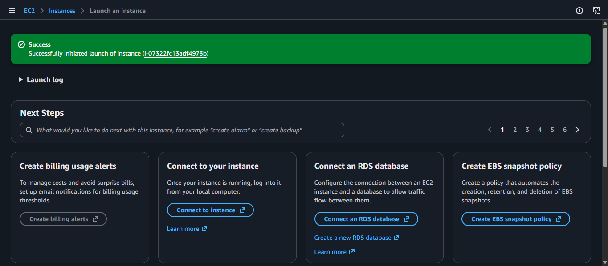
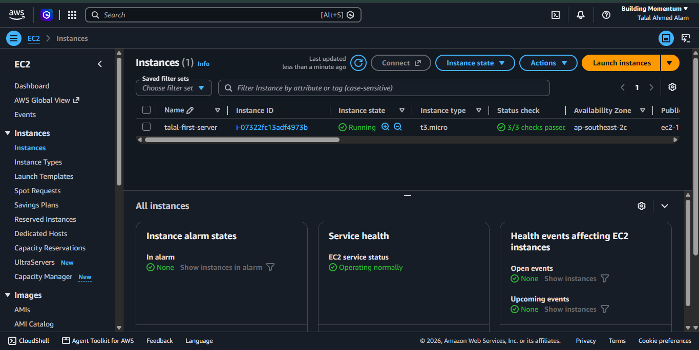
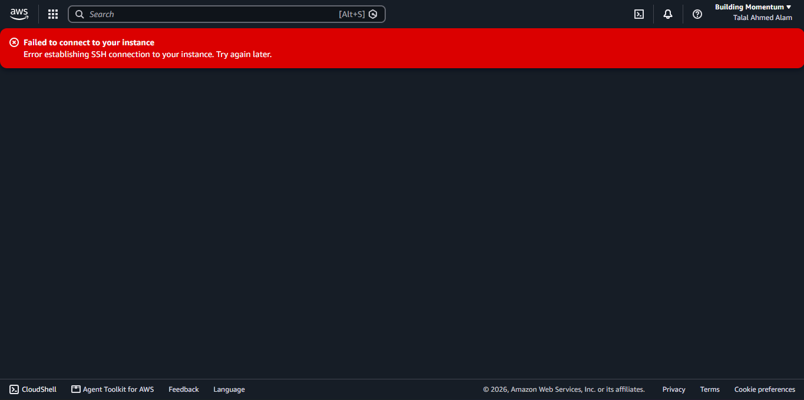
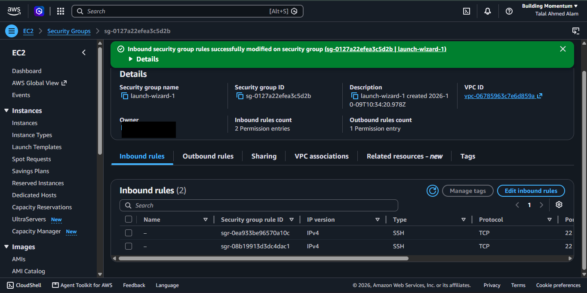
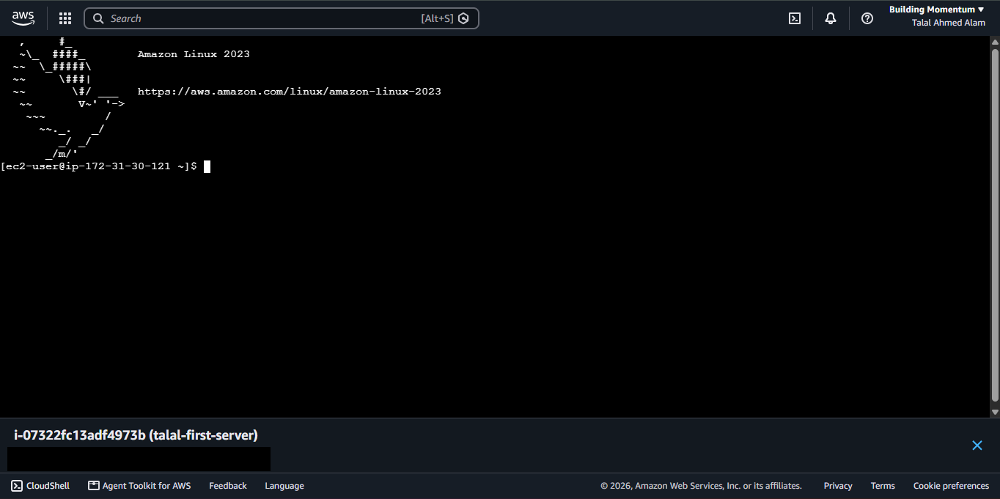
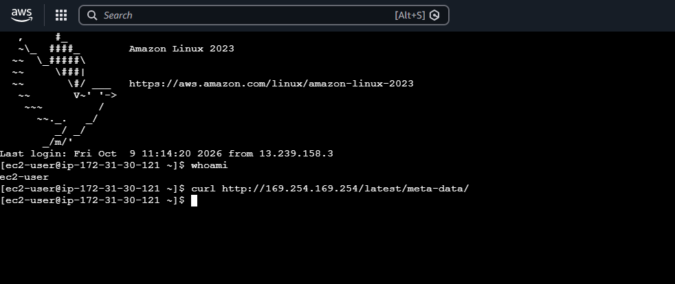
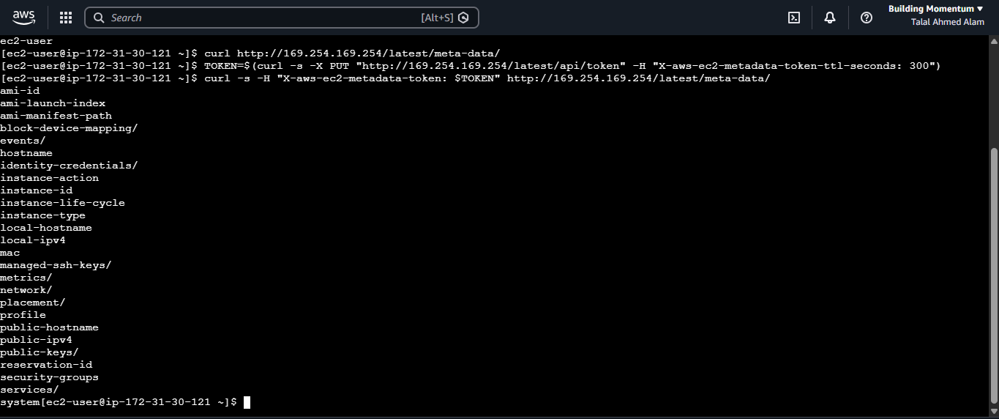

# Lab 01 — Launching a Secure EC2 Instance & Exploring IMDSv2

**Date:** 9 October 2026
**Region:** Asia Pacific (Sydney) — ap-southeast-2
**Instance:** Amazon Linux 2023, t3.micro

## Objective

Launch my first EC2 instance the *secure* way, connect to it, and explore the
Instance Metadata Service (IMDS) — the exact service abused in the 2019
Capital One breach — to see how IMDSv2 protects it.

## Step 1 — Launch with least-privilege networking

- Created an SSH key pair (RSA, `.pem`) for login.
- Security group: SSH (port 22) allowed **only from my own IP (/32)** — not
  from the whole internet.





## Step 2 — A real-world problem, fixed properly

Browser-based **EC2 Instance Connect failed** with "Error establishing SSH
connection":



**Root cause:** Instance Connect originates from **AWS's own IP range**, which
my strict security group was correctly blocking. The error was my security
working as designed.

**Fix:** instead of opening SSH to the world (0.0.0.0/0), I added a second SSH
rule for only the official **EC2 Instance Connect IP range for ap-southeast-2 —
13.239.158.0/29** (a /29 = just 8 addresses):



Login then worked — and the terminal banner proved the rule was doing its job:
my session arrived *from 13.239.158.3*, inside that exact range.



## Step 3 — Testing the metadata service (169.254.169.254)

**Old style (IMDSv1)** — no token:

```bash
curl http://169.254.169.254/latest/meta-data/
```

→ **Empty response.** This instance enforces IMDSv2:



**New style (IMDSv2)** — request a session token first, then query with it:

```bash
TOKEN=$(curl -s -X PUT "http://169.254.169.254/latest/api/token" \
  -H "X-aws-ec2-metadata-token-ttl-seconds: 300")
curl -s -H "X-aws-ec2-metadata-token: $TOKEN" \
  http://169.254.169.254/latest/meta-data/
```

→ The full metadata tree was returned (instance-id, instance-type, placement,
security-groups, public-ipv4, …):



**Key observation:** the metadata tree has **no `iam/` entry** — this instance
has **no IAM role attached**, so there are no credentials available to steal
even if an SSRF flaw existed. In the Capital One breach, the metadata
credentials were the prize. Here, that prize doesn't exist.

## Step 4 — Cleanup

Terminated the instance after the lab. A resource that doesn't exist can't be
attacked — and doesn't consume credits.

## Security takeaways

- Restrict SSH to specific source IPs; never 0.0.0.0/0 for admin access.
- When opening access, open it for the *smallest possible range* (a /29
  service range, not the world).
- **IMDSv2 (token-required) blocks the classic SSRF → metadata attack path.**
- Don't attach IAM roles to instances that don't need them — no role means
  no credentials waiting in metadata.
- Terminate practice resources when done (cost + attack surface).

*Account ID and IP addresses are redacted from the screenshots. Private keys
are never committed — see the repo's `.gitignore`.*
