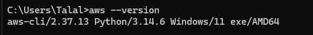
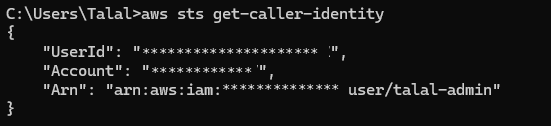
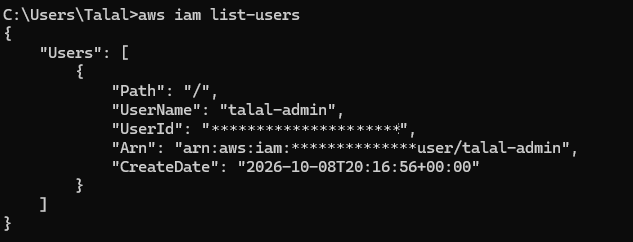
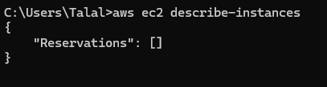

# Lab 02 — AWS CLI Setup, First Commands & a Live Key Rotation

**Date:** 13 October 2026
**Region:** Asia Pacific (Sydney) — ap-southeast-2
**Setup:** Windows 11 · AWS CLI v2 (2.37.13) · IAM user `talal-admin`

## Objective

Move from clicking in the AWS Console to controlling the account from the
command line: create an access key for my IAM user *safely*, install and
configure the AWS CLI, verify my programmatic identity, and run my first
read-only commands. This lab also ended with a real security incident — and
the correct response to it.

## Step 1 — Create an access key (the careful way)

In IAM → `talal-admin` → **Create access key**, I chose the
**Command Line Interface (CLI)** use case and acknowledged AWS's warning
about long-term credentials.

The **secret access key is shown exactly once**. My rules for it:

- Download the **`.csv` file first**, then click Done — there is no second chance.
- The secret **never** goes into chat, screenshots, code, or Git.

## Step 2 — Install the AWS CLI

Installed the official AWS CLI v2 MSI for Windows and verified:



During `aws configure`, the CLI also offered to set up AWS skills and an MCP
server for AI coding agents. I answered **`n`** — I don't use a local AI
coding agent, and I only install what I actually need.

## Step 3 — Configure, and two real errors

```bash
aws configure
# AWS Access Key ID     → from the .csv (starts with AKIA, 20 chars)
# AWS Secret Access Key → from the .csv (40 chars — a different value!)
# Default region name   → ap-southeast-2
# Default output format → json
```

My first attempts failed with two classic errors, both my own copy-paste:

| Error | Real cause |
|---|---|
| `IncompleteSignature` — "Invalid key=value pair in Authorization header" | I had pasted the **whole .csv line** (key ID + secret together) into the fields |
| `SignatureDoesNotMatch` — "Check your AWS Secret Access Key" | The key ID was now right (AWS recognised it), but the **secret was copied incompletely** |

**Lesson:** the access key ID and the secret are two *different* values —
copy each one separately and completely. The error messages themselves tell
you which half is wrong if you read them carefully.

## Step 4 — Verify identity, run first commands

```bash
aws sts get-caller-identity
```

→ This is the "who am I?" call — it proves the CLI is authenticated as
`talal-admin` before I touch anything else:



```bash
aws iam list-users
```



```bash
aws ec2 describe-instances
```

→ `"Reservations": []` — correctly empty. The Lab 01 instance stayed
terminated; nothing is running (or billing) behind my back:



## Step 5 — The incident: my key appeared in screenshots, so I rotated it

While preparing this write-up, I took terminal screenshots of the
`aws configure` session — and the screenshots **showed my secret access key
in plain text** (from the failed paste attempts in Step 3). The screenshots
were only shared inside a private chat and were **never published** — but a
secret that has left its one safe place has to be treated as compromised.

The response — the standard rotation sequence, done immediately:

1. **Create** a replacement key (downloaded the `.csv` first, this time).
2. **Reconfigure** the CLI with the new key and **verify**
   (`aws sts get-caller-identity` succeeded).
3. **Delete** the exposed key. It is now dead — the leaked screenshots are
   worthless pieces of history.

One more discipline note: my first replacement key was created *without*
downloading its `.csv` — that key was deleted unused and recreated
properly. A secret you didn't save does not exist; delete and redo, don't
improvise.

## Security takeaways

- **The secret is shown once.** Download the `.csv` *before* clicking Done.
- **Never screenshot a terminal while handling credentials** — screenshots
  for a write-up come afterwards, from fresh read-only commands only.
- **Leaked = rotate, immediately.** New key → verify → delete old. No
  debate, no "it's probably fine".
- Published screenshots get their account and user IDs replaced with
  `************` — verified by eye before every push.
- Read AWS error messages literally: `IncompleteSignature` vs
  `SignatureDoesNotMatch` pointed at two different halves of the credential.
- Decline tooling you don't need (the CLI's AI-agent/MCP offer) — every
  extra integration is extra attack surface.

*Account and user IDs are masked with asterisks in the screenshots. No
credential — current or deleted — appears anywhere in this repository.*
