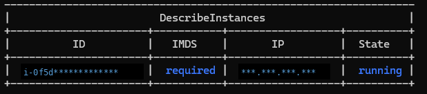
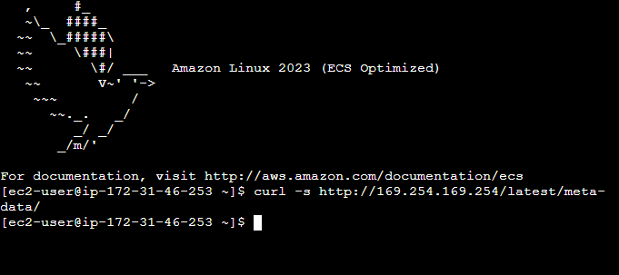
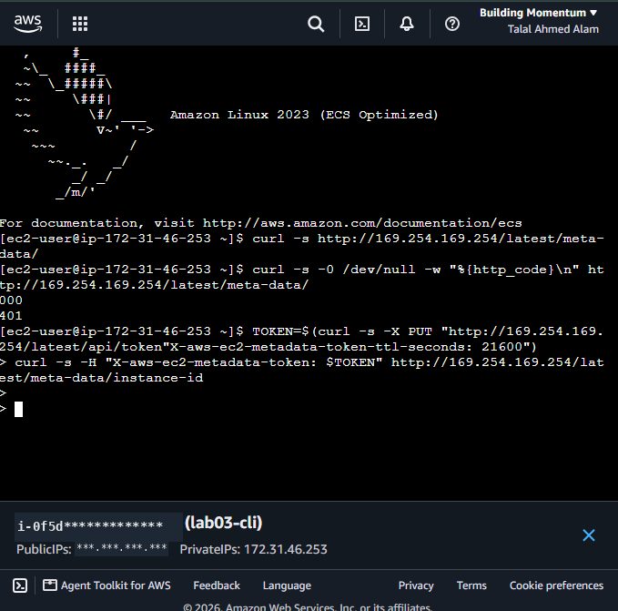
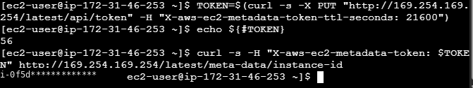
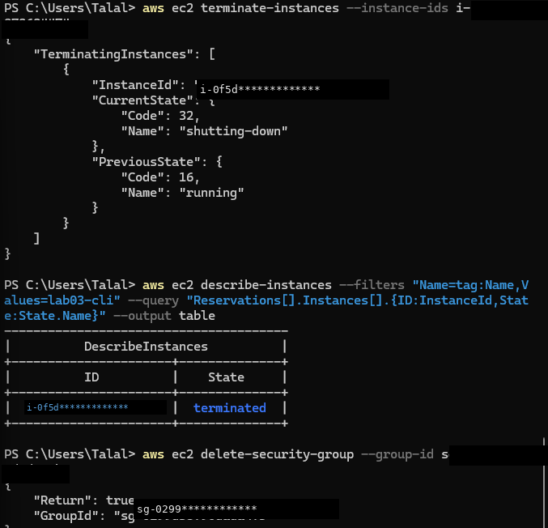

# Lab 03 — The Same Secure EC2 Launch, 100% From the CLI

**Date:** 21–22 October 2026
**Region:** Asia Pacific (Sydney) — ap-southeast-2
**Setup:** Windows 11 · PowerShell · AWS CLI v2 · IAM user `talal-admin`
**Instance:** Amazon Linux 2023, t3.micro, launched with **no key pair** and a
security group with **no inbound rules**

> All account, instance and security-group IDs in this write-up and its
> screenshots are masked; the AMI ID is Amazon's public image identifier
> and is shown in full.

## Objective

Lab 01 launched a secure EC2 instance by clicking in the console. This lab
repeats the same launch — least-privilege networking, IMDSv2 enforced — with
**zero console clicks for the build itself**: find the image, create the
security group, and launch, all from the AWS CLI. If it can't be done from
the command line, it isn't really *operated* — it's just visited.

## Step 1 — Verify the CLI before touching anything

```powershell
aws sts get-caller-identity
aws configure get region
```

Identity confirmed as `talal-admin`, region `ap-southeast-2`. (No screenshot
of this step — the output contains the account ID. That is the Lab 02 rule:
screenshots for a write-up are taken afterwards, from safe commands only.)

## Step 2 — Find the latest Amazon Linux 2023 image (AMI)

A launch needs an image ID, and hard-coding one from a tutorial is how you
end up booting something old — or someone else's. Query for it instead:

```powershell
aws ec2 describe-images --owners amazon --filters "Name=name,Values=al2023-ami-*-x86_64" --query "sort_by(Images,&CreationDate)[-1].ImageId" --output text
```

→ `ami-0ef0148acb5ba8a17` — the newest Amazon Linux 2023 image in Sydney.

- `--owners amazon` — **only Amazon's own images.** Booting a stranger's
  image is running a stranger's code.
- `sort_by(...)[-1]` — sort by creation date and take the latest, so the
  command stays correct next month without editing it.

One honest wrinkle: the name pattern also matches Amazon's ECS-optimized
variant of AL2023, and that day's newest image was that variant (its banner
shows in the Step 5–6 screenshots). Still an Amazon-owned Amazon Linux 2023
image, so the lab stands — but a production command should pin the exact
variant it wants instead of just the newest name match.

## Step 3 — Create a security group with NO inbound rules

```powershell
aws ec2 create-security-group --group-name lab03-sg --description "Lab 03 CLI launch, no inbound"
```

→ GroupId `sg-0299************`

The deliberate choice: **no `authorize-security-group-ingress` call at all.**
Lab 01 restricted SSH to my own IP; this lab goes one step further — a port
that was never opened cannot be scanned, brute-forced, or forgotten. Access
will come through EC2 Instance Connect instead of a standing open port, so
no key pair is needed either.

## Step 4 — Launch, with IMDSv2 required from the first second

```powershell
aws ec2 run-instances --image-id ami-0ef0148acb5ba8a17 --instance-type t3.micro --count 1 --security-group-ids sg-0299************ --metadata-options "HttpTokens=required,HttpEndpoint=enabled" --tag-specifications "ResourceType=instance,Tags=[{Key=Name,Value=lab03-cli}]"
```

The security decision in this command is `--metadata-options
"HttpTokens=required,..."`: IMDSv2 is enforced **at launch**, not hardened
afterwards. There is no window — not even a few minutes — in which the old
token-less metadata path (the one abused in the Capital One breach) is open.

First status check came back half-populated (`State: running`, ID and IP
still `None`) because the instance was still coming up; re-running the query
a moment later gave the full picture:

```powershell
aws ec2 describe-instances --filters "Name=tag:Name,Values=lab03-cli" --query "Reservations[].Instances[].{ID:InstanceId,State:State.Name,IP:PublicIpAddress,IMDS:MetadataOptions.HttpTokens}" --output table
```

| Field | Value |
|---|---|
| ID | `i-0f5d*************` |
| State | `running` |
| IMDS | **`required`** ✓ — verified from *outside* the instance, before ever logging in |



## Step 5 — Instance Connect fails — because the firewall works

Opening EC2 Instance Connect from the console failed with an SSH connection
error. Root cause, same lesson as Lab 01 but stricter: the security group
has **no** inbound rules, so it also blocks AWS's own Instance Connect
service. Nothing is broken — the firewall is doing exactly what it was told.

The fix, done **from the CLI** to keep the lab console-free, and scoped to
the smallest possible range — the official Instance Connect range for
Sydney, `13.239.158.0/29` (8 addresses), never `0.0.0.0/0`:

```powershell
aws ec2 authorize-security-group-ingress --group-id sg-0299************ --protocol tcp --port 22 --cidr 13.239.158.0/29
```

Instance Connect then opened the terminal immediately. (This rule dies with
the security group at cleanup — it is a lab door, not a standing one.)



## Step 6 — Prove IMDSv2 from inside the instance

**IMDSv1 attempt (no token):**

```bash
curl -s http://169.254.169.254/latest/meta-data/
```

→ Empty response — suggestive, but an empty reply is weak evidence. Ask for
the status code explicitly:

```bash
curl -s -o /dev/null -w "%{http_code}\n" http://169.254.169.254/latest/meta-data/
```

→ **`401`** — the token-less path is refused, in writing.



**IMDSv2 flow (token first, then query)** — with a real debugging lesson.
My first attempt pasted both commands together; a quoting glitch left the
shell sitting at a continuation prompt (`>`), and pressing Ctrl+C to escape
cancelled **both** commands — so the follow-up query ran with an *empty*
`$TOKEN` and silently returned nothing. The diagnosis was to check the
variable, not the network:

```bash
TOKEN=$(curl -s -X PUT "http://169.254.169.254/latest/api/token" -H "X-aws-ec2-metadata-token-ttl-seconds: 21600")
echo ${#TOKEN}
```

→ Length must be non-zero (typically 56). `0` means the token was never
set — re-run the PUT on its own, *then* query:

```bash
curl -s -H "X-aws-ec2-metadata-token: $TOKEN" http://169.254.169.254/latest/meta-data/instance-id
```

→ Returns the instance ID: with a token, the door opens; without one, 401.



## Step 7 — Cleanup

```powershell
aws ec2 terminate-instances --instance-ids i-0f5d*************
aws ec2 describe-instances --filters "Name=tag:Name,Values=lab03-cli" --query "Reservations[].Instances[].{ID:InstanceId,State:State.Name}" --output table
aws ec2 delete-security-group --group-id sg-0299************
```

→ State verified as `terminated`, and the security group deletion returned
`"Return": true` — so the temporary Instance Connect rule from Step 5 died
with it. A resource that doesn't exist can't be attacked — and doesn't
consume credits.



## Security takeaways

- **CLI-only is a security skill, not a party trick.** A launch you can
  script is a launch you can review, repeat, and audit — a console session
  evaporates.
- **Secure at launch, not after.** `HttpTokens=required` was set in the
  `run-instances` call itself; there was never a moment when IMDSv1 worked.
- **No inbound rules beats restricted inbound rules.** Lab 01 allowed SSH
  from one IP; Lab 03 opened nothing at all and borrowed access through
  Instance Connect only when needed.
- **When you must open a door, open the smallest one** — a /29 service
  range (8 IPs), added via CLI, removed at cleanup.
- **Verify from outside *and* inside.** `MetadataOptions.HttpTokens` in the
  describe output proved the setting; the in-instance `401` proved the
  behaviour. Settings are claims; behaviour is evidence.
- **An empty response is not proof — an HTTP status code is.** `-w
  "%{http_code}"` turned "nothing came back" into a documented `401`.
- **Debug the variable before the network.** `echo ${#TOKEN}` found in one
  second what re-running curl would never have shown: the token was empty
  because Ctrl+C had cancelled its assignment too.

*Account ID, instance/security-group IDs and IP addresses are masked or
redacted in this write-up and its screenshots. No credential appears
anywhere in this repository. Practice resources are terminated at lab end.*
