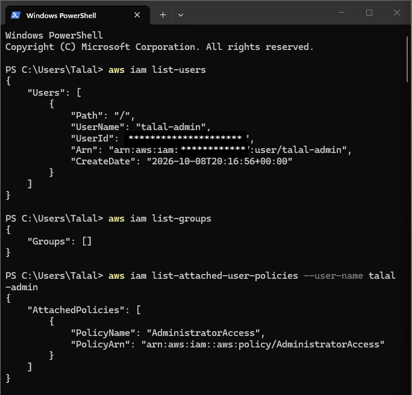
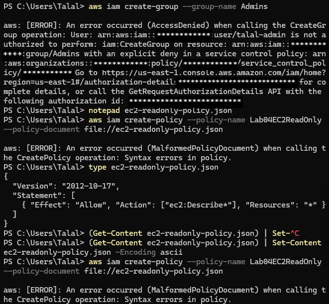
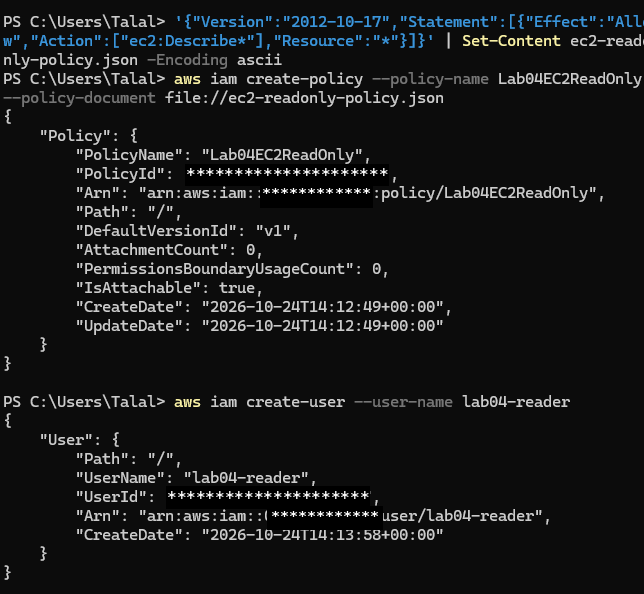
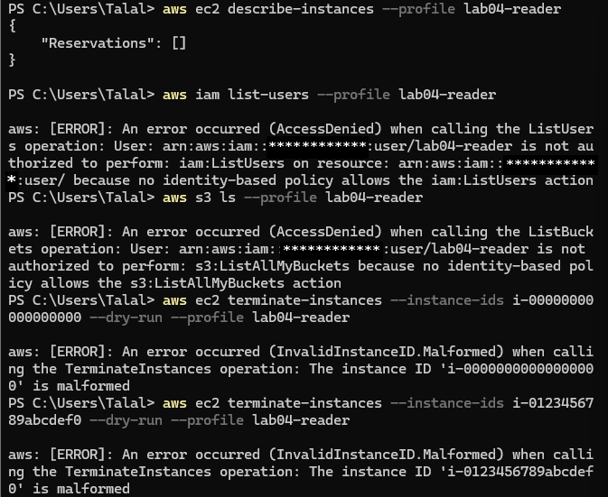
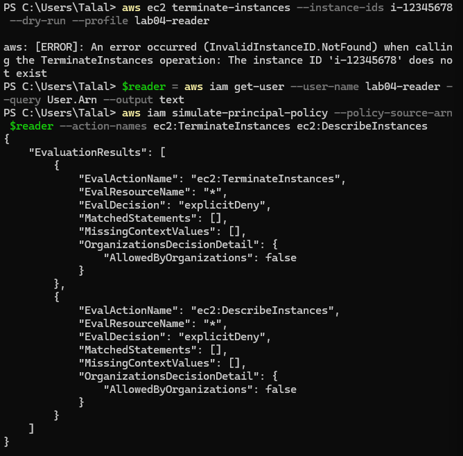
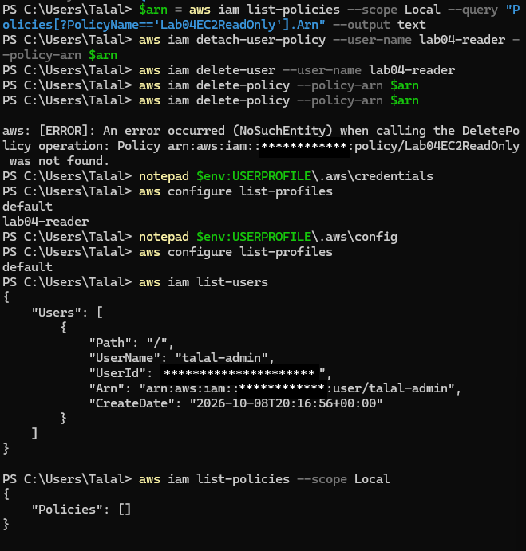

# Lab 04 — IAM Deep-Dive, Adapted: Least Privilege, Proven

**Date:** 24 October 2026
**Region:** Asia Pacific (Sydney) — ap-southeast-2
**Setup:** Windows 11 · PowerShell · AWS CLI v2 · IAM user `talal-admin`
**Status:** Complete — proofs captured, lab artefacts deleted, local
profile removed

> All account IDs, user IDs, policy IDs and organisation IDs in this
> write-up and its screenshots are masked with `************`. No
> credential appears anywhere in this repository. There is deliberately
> no screenshot of the access-key creation step — the secret is shown
> once, and a screenshot of it would be a second leak.

## Objective (as adapted on the day)

Lab 03 proved a secure launch. This lab was meant to fix a structure
problem: `talal-admin`'s `AdministratorAccess` was attached directly to
the user instead of through a group, and to prove least privilege with a
read-only user. The group part turned out to be blocked by the account's
organisation (see Step 2), so the lab adapted: the least-privilege proof
now comes from the policy + reader user, and the admin-structure fix is
recorded as **not completed**, not quietly dropped. A write-up that
claimed "admin moved to a group" when the SCP blocked it would be a
false claim — so this one says so, plainly.

## Step 1 — Inventory: the starting structure, verified

```powershell
aws iam list-users
aws iam list-groups
aws iam list-attached-user-policies --user-name talal-admin
```

Verified on 24 October 2026:

- Only one user: `talal-admin`
- No groups at all (empty list)
- `AdministratorAccess` attached **directly** to `talal-admin` — the
  structure this lab was meant to fix



## Step 2 — The group step is SCP-blocked (a finding, not a failure)

```powershell
aws iam create-group --group-name Admins
```

→ Explicit deny. An organisation-level Service Control Policy (SCP)
denies `iam:CreateGroup`. An SCP sits **above** `AdministratorAccess`,
so being an admin does not override it, and it cannot be removed from
this account — it belongs to the organisation's admin.

Consequence, stated plainly: the Admins group was never created, so the
planned "move admin power to the group, then detach it from the user"
sequence was **not** run. `talal-admin` still has its direct
`AdministratorAccess` attachment at the end of this lab. Do **not**
detach it as a cleanup step — with no group in place, that would be a
lockout risk, not a fix. The honest write-up line is: *group-based
admin structure: blocked by SCP, not remediated on this account.*



## Step 3 — The policy: a BOM lesson, then a clean file

Policy intent: allow only `ec2:Describe*`, nothing else.

```json
{
  "Version": "2012-10-17",
  "Statement": [
    { "Effect": "Allow", "Action": ["ec2:Describe*"], "Resource": "*" }
  ]
}
```

What actually happened, in order:

1. First `create-policy` failed with a syntax error — but the SCP did
   **not** stop it, which itself proved policy creation is allowed on
   this account. Authorisation passed; validation failed.
2. The file looked correct and PowerShell parsed it fine
   (`ConvertFrom-Json` succeeded), so the content was not the problem.
3. The culprit was invisible: Notepad had added a BOM (byte-order mark)
   at the start of the file, which AWS rejected as malformed JSON. A BOM
   does not show in `type` output or in an editor.
4. Fix that worked — build the file from PowerShell in ASCII, so no
   BOM can sneak in:

```powershell
'{"Version":"2012-10-17","Statement":[{"Effect":"Allow","Action":["ec2:Describe*"],"Resource":"*"}]}' | Set-Content ec2-readonly-policy.json -Encoding ascii
aws iam create-policy --policy-name Lab04EC2ReadOnly --policy-document file://ec2-readonly-policy.json
```

→ Policy `Lab04EC2ReadOnly` created. Lesson to keep: *when JSON parses
locally but AWS calls it malformed, check the file encoding, not the
JSON.* (The create-policy output contains the policy ARN, which
includes the account ID — that line is masked in the screenshot.)

## Step 4 — Reader user, policy attached directly (group substitute)

Groups are blocked, so the policy went directly onto the user — the
correct structure is groups, but a blocked step is not a reason to stop
the lab, it is a reason to record the deviation:

```powershell
aws iam create-user --user-name lab04-reader
aws iam attach-user-policy --user-name lab04-reader --policy-arn <policy-Arn-from-your-own-screen-do-not-paste-it-in-chat>
```

Safer variant (no ARN typing at all — the CLI looks it up):

```powershell
$arn = aws iam list-policies --scope Local --query "Policies[?PolicyName=='Lab04EC2ReadOnly'].Arn" --output text
aws iam attach-user-policy --user-name lab04-reader --policy-arn $arn
```

Verified:

```powershell
aws iam list-attached-user-policies --user-name lab04-reader
```

→ `Lab04EC2ReadOnly` shown attached. (This output also contains an
ARN — masked in the screenshot.)



## Step 5 — Key, profile, and the proof

The secret appears **once**:

```powershell
aws iam create-access-key --user-name lab04-reader
aws configure --profile lab04-reader
# Access Key ID -> from the create-access-key output
# Secret Access Key -> from the same output, typed, never pasted in chat
# Region -> ap-southeast-2
# Output -> json
```

**No screenshot of the create-access-key terminal, and no secret in
chat** — the Lab 02 rotation lesson applies again. (Two small
environment notes from this step: the newer AWS CLI also asks about
configuring AI-agent skills — answered `n`, it is unrelated to the lab
— and `aws configure --profile` writes **two** files, `credentials`
and `config`, which matters at cleanup.)

One real stumble, worth recording: the first proof run failed with
"the config profile could not be found" — because the `configure`
step had been skipped and the run went straight to the proof commands.
The profile only exists after `configure` completes. Order is the
lab: key → configure → proof.

**The proof itself — one PASS, two live denies:**

```powershell
aws ec2 describe-instances --profile lab04-reader
```

→ `{"Reservations": []}` — **PASS.** Describe works, and the empty
list is expected: Lab 03's instance was terminated, so nothing is
running.

```powershell
aws iam list-users --profile lab04-reader
aws s3 ls --profile lab04-reader
```

→ Both **`AccessDenied`** — "no identity-based policy allows the
`iam:ListUsers` / `s3:ListMyBuckets` action". Those two failures
**are** the evidence that the policy boundary holds — do not "fix"
them.



**The terminate proof, honestly told.** The planned fourth proof —
`terminate-instances --dry-run` against a fake instance ID — never
reached the authorisation check at all:

- A 17-character fake ID was rejected as `InvalidInstanceID.Malformed`
  (a character-count slip while typing it).
- A corrected 17-character ID was rejected as `Malformed` again.
- An 8-character ID passed format validation but returned
  `InvalidInstanceID.NotFound` — EC2 checks that the instance exists
  **before** it evaluates the caller's permission, so a dry run
  against a nonexistent instance cannot produce an IAM denial.

So the terminate proof came from the Policy Simulator instead, which
needs no instance at all:

```powershell
$reader = aws iam get-user --user-name lab04-reader --query User.Arn --output text
aws iam simulate-principal-policy --policy-source-arn $reader --action-names ec2:TerminateInstances ec2:DescribeInstances
```

→ `ec2:TerminateInstances` = **`explicitDeny`** — the terminate denial,
on paper. (Run without `--profile`, from the admin default profile:
the reader cannot read its own ARN.)



**One contradiction, handled honestly.** The simulator also returned
`explicitDeny` for `ec2:DescribeInstances` — which contradicts the live
result, where Describe **succeeded**. The simulator evaluates the
organisation SCP as well (note `AllowedByOrganizations: false` in its
output), and its SCP evaluation does not match the live EC2
authorisation path. When a prediction contradicts a live call, the live
call wins: Describe is allowed, the simulator's Describe verdict is
recorded here as organisation-guardrail evidence, not as a denial of
the reader's Describe permission.

## Step 6 — Cleanup, in dependency order

Delete in the wrong order and AWS refuses — that refusal is itself a
lesson, and it happened once here: `delete-policy` run a second time
returned `NoSuchEntity`, because the first run had already deleted it.

```powershell
aws iam list-access-keys --user-name lab04-reader
aws iam delete-access-key --user-name lab04-reader --access-key-id <key-id-from-the-create-output>
$arn = aws iam list-policies --scope Local --query "Policies[?PolicyName=='Lab04EC2ReadOnly'].Arn" --output text
aws iam detach-user-policy --user-name lab04-reader --policy-arn $arn
aws iam delete-user --user-name lab04-reader
aws iam delete-policy --policy-arn $arn
```

Then the local profile — from **both** files, because `configure`
writes two: delete the `[lab04-reader]` section from `credentials`
and the `[profile lab04-reader]` section from `config`, leaving
`[default]` (`talal-admin`) untouched. Verified afterwards:

```powershell
aws configure list-profiles
aws iam list-users
aws iam list-policies --scope Local
```

→ Profiles: only `default`. Users: only `talal-admin`. Local
policies: empty. Nothing lab-related remains; `talal-admin`'s
attachment state is left exactly as found, because the group remedy is
SCP-blocked.



## Security takeaways

- **An SCP outranks an admin.** A denied `CreateGroup` on an admin
  account is not a permissions mistake — it is organisation policy, and
  the correct response is to record it and adapt, not to force it.
- **Encoding is a security-adjacent bug class.** A BOM is invisible in
  `type` output and in an editor, yet it broke a policy deployment; the
  fix was to generate the file in a controlled encoding, not to edit
  the JSON again.
- **A policy is a claim; an AccessDenied is evidence.** The reader
  user's boundary is only proven when Describe passes and IAM, S3 and
  Terminate all fail.
- **Dry-run validation order matters.** EC2 checks format, then
  existence, before authorisation — so a dry run against a fake
  instance cannot prove an IAM denial. Know what a test actually
  tests before trusting its error.
- **A simulator is a prediction; a live call is proof.** When the two
  disagree, believe the live call and say why.
- **Leave the known gap visible.** Publishing "admin moved to a group"
  when the SCP blocked it would be a false claim. The write-up must say
  the group fix is blocked and the direct attachment remains.
- **Cleanup is two files, not one.** `aws configure --profile` writes
  `credentials` and `config`; removing the profile means both, or
  `list-profiles` will keep showing it.

*Account IDs, user IDs, policy IDs and organisation IDs are masked or
redacted in this write-up and its screenshots. No credential appears
anywhere in this repository. Practice resources are removed at lab end;
`talal-admin`'s attachment state is left exactly as found, because the
group remedy is SCP-blocked.*
